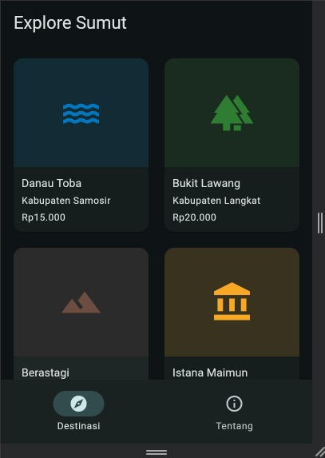
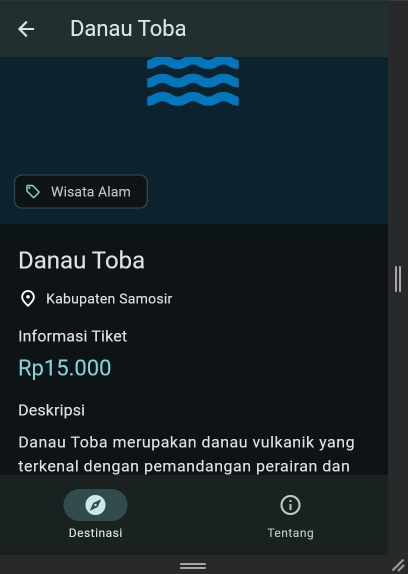
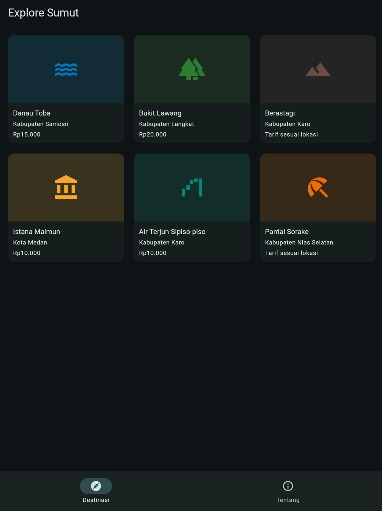
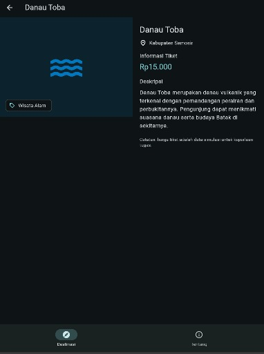

# Tugas Rutin 6 — Explore Sumut

## Identitas Mahasiswa

**Nama:** Benedict Sandi Pangestu Rosa  
**NIM:** 4243250006  
**Kelas:** PSIK 24 D  
**Program Studi:** Ilmu Komputer  
**Fakultas:** Matematika dan Ilmu Pengetahuan Alam  
**Universitas:** Universitas Negeri Medan  
**Mata Kuliah:** Pemrograman Mobile  
**Dosen Pengampu:** Adidtya Perdana, S.T., M.Kom.

## Deskripsi Aplikasi

Explore Sumut adalah aplikasi panduan wisata Sumatera Utara yang dikembangkan menggunakan Flutter dan Dart. Aplikasi menampilkan enam destinasi wisata beserta lokasi, kategori, deskripsi, dan informasi tiket.

Aplikasi dirancang secara responsif sehingga tampilan daftar destinasi, halaman detail, dan komponen navigasi menyesuaikan ukuran layar ponsel, tablet, maupun komputer.

## Fitur Aplikasi

1. Menampilkan enam destinasi wisata Sumatera Utara.
2. Grid responsif dengan dua, tiga, atau empat kolom.
3. Halaman detail destinasi dengan URL berdasarkan ID.
4. Penanganan ID destinasi tidak dikenal.
5. Layout detail vertikal pada layar sempit dan berdampingan pada layar lebar.
6. Label kategori menggunakan Stack dan Positioned.
7. Navigasi adaptif menggunakan NavigationBar dan NavigationRail.
8. Antarmuka menggunakan Material Design 3.

## Teknologi

- Flutter dan Dart
- Material Design 3
- `go_router`
- `LayoutBuilder`
- `MediaQuery.sizeOf`
- `GridView.builder`
- `NavigationBar` dan `NavigationRail`

## Dokumentasi Tampilan

### 1. Daftar Destinasi — Ponsel



### 2. Detail Destinasi — Ponsel



### 3. Daftar Destinasi — Tablet



### 4. Detail Destinasi — Tablet



## Penjelasan Keputusan Desain Responsif

Dalam pengembangan Explore Sumut, saya menggunakan pendekatan desain responsif agar antarmuka dapat menyesuaikan ruang yang tersedia pada perangkat berbeda. Pada halaman daftar destinasi, `LayoutBuilder` digunakan untuk membaca lebar area konten, kemudian menentukan jumlah kolom pada `GridView.builder`. Jika lebarnya kurang dari 600 dp, grid menggunakan dua kolom. Pada lebar 600 hingga kurang dari 900 dp, grid menggunakan tiga kolom, sedangkan ruang yang lebih lebar menggunakan empat kolom.

Untuk navigasi utama, saya memilih `MediaQuery.sizeOf(context)` karena keputusan tata letak dibuat berdasarkan ukuran keseluruhan aplikasi. Pada lebar kurang dari 840 dp, navigasi ditampilkan menggunakan `NavigationBar` di bagian bawah. Jika lebarnya mencapai 840 dp atau lebih, navigasi berubah menjadi `NavigationRail` di sisi kiri.

Halaman detail memakai `LayoutBuilder` dengan batas 700 dp. Pada layar sempit, ilustrasi destinasi berada di atas informasi, sedangkan pada layar lebar keduanya ditampilkan berdampingan. Saya juga menggunakan `Expanded`, `TextOverflow.ellipsis`, dan widget yang dapat digulir untuk membantu mencegah overflow. Pemilihan ini membuat informasi lebih mudah dibaca pada ponsel maupun tablet.

## Cara Menjalankan

```bash
flutter pub get
flutter run -d chrome
```

## Pengujian

```bash
dart format .
flutter analyze
flutter test
```

Pengujian manual dilakukan dengan mengubah lebar viewport menjadi 360 dp, 600 dp, 800 dp, 900 dp, dan 1280 dp, kemudian memeriksa perubahan grid, navigasi, dan susunan halaman detail.

Hasil akhir pengujian perlu disesuaikan dengan keluaran yang benar-benar diperoleh saat aplikasi dijalankan.

## Pernyataan Penggunaan AI

Saya menggunakan ChatGPT sebagai alat bantu memahami konsep layout responsif, navigasi Flutter, penyusunan dan peninjauan kode, serta dokumentasi proyek. Saya memeriksa dan menguji implementasi menggunakan Visual Studio Code dan Flutter.

## Referensi

Perdana, A. (2026). *Modul Ajar Pemrograman Mobile Pertemuan 6: Layout Responsif dan Navigasi Multi-Screen di Flutter*. Universitas Negeri Medan.

Flutter Documentation. https://docs.flutter.dev/

go_router. https://pub.dev/packages/go_router